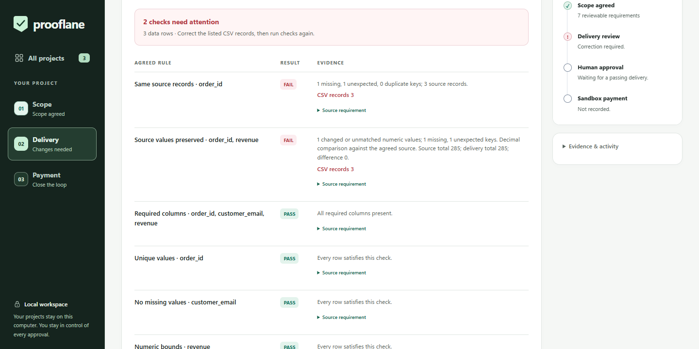
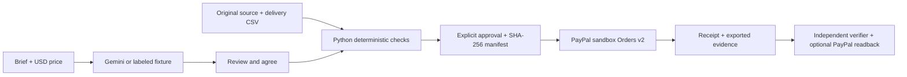

# Prooflane — Proof Before Payment

**Catch incorrect data delivery before payment, and verify exactly what the payment was for.**

For independent data freelancers, small analytics agencies, and their clients. Gemini drafts reviewable acceptance checks from a brief. Python checks the delivered CSV against the agreement and original source. A person approves the exact passing version; PayPal sandbox checkout records a reference to that agreement and delivery.



Actual current interface: live Gemini, synthetic CSVs, and blocked incorrect delivery. **[Watch the captioned functional demo (2:44.8 MP4)](submission/media/prooflane-demo.mp4)** or open the [submission package](submission/). **YouTube publication and final Devpost submission are pending**; no public YouTube URL or submitted entry is claimed.

## Five-minute quick start

Python **3.11+** is the only runtime requirement. No pip/npm installation, API key, paid service, or database account is needed.

```bash
git clone https://github.com/AaryaMody1301/Prooflane.git
cd Prooflane
python app.py
```

Use `python3` if that is your Python command. Open **http://127.0.0.1:8787**. Stop with Ctrl+C. Projects persist in the ignored `prooflane.sqlite3` file.

A fresh clone defaults to **Sample AI fixture + Simulated payments**. The fixture does not call Gemini; simulation does not contact PayPal or transfer money. Checks, correction previews, approval binding, evidence export, and persistence are real local functionality in both modes.

### The recommended judge walkthrough

1. Choose **Compare a delivery with its source**. Draft the supplied brief at USD 1.00 (or keep the default USD 120.00).
2. Review all **seven** proposed checks. Attach `examples/source.csv`, then choose **Agree on these checks**.
3. In Delivery, load `examples/substituted.csv` or **Try a substituted order** and run checks. Five structural rules pass. Source comparison catches the missing order and its replacement even though the total remains 285. Checkout stays blocked.
4. Try `examples/changed-value.csv`. Its keys pass, but the per-order decimal check detects a **USD 0.01** difference.
5. Choose **Preview source corrections** and review the before/after source value. **Apply reviewed corrections** changes only the in-memory preview. **Undo CSV changes** restores it. Both require fresh checks; after Undo, recheck before requesting another correction.
6. Apply the reviewed correction, run all seven checks, and explicitly **Approve this delivery**. In the CSV preview, **Download this CSV preview** to retain the exact corrected file.
7. Create and complete the **simulated** checkout. The receipt labels the modes and binds the price, agreement, source and approved delivery through a version 2 manifest.
8. Download the evidence JSON. Choose **Verify files and receipt separately**, attach that export, the downloaded delivery, and `examples/source.csv`. Run the separate verifier. Replacing the delivery with `examples/changed-value.csv` clears the success and fails verification.
9. Restart the app and reopen the saved receipt. The preview files must be reattached after a reload; raw CSV rows are not stored in the project database.

See the [judge guide](submission/JUDGE_GUIDE.md) for expected results and troubleshooting. **Try a clarification example** separately demonstrates vague scope: agreement is blocked until a new measurable draft is reviewed. Sample mode accepts only the supplied briefs. Custom briefs require Gemini.

## What makes this more than a validator or payment button

- Seven restricted checks: columns, unique nonempty keys, present values, numeric ranges, row count, exact source keys, and decimal source values per key.
- Corrections restore only agreed source records/values; conflicting keys require manual review. No generated code executes and no source values are invented.
- Human-reviewed scope and an exact USD price precede delivery. A changed preview requires fresh checks and approval.
- A canonical manifest covers the brief, plan, integer cents, modes, source snapshot and approved delivery hash. Its digest travels in PayPal Orders v2 `custom_id`.
- Checkout freezes evidence before the provider request. Stable create/capture request IDs, readback before capture, exact amount/reference checks and replay handling prevent blind repeated captures.
- The standalone verifier works without the original database and distinguishes local consistency from authenticated provider confirmation.



## Optional real Gemini and PayPal sandbox

Copy `.env.example` to `.env` **only if `.env` does not already exist**. Keep keys local; `.env`, databases and `.venv` are ignored.

```dotenv
AI_MODE=gemini
GEMINI_API_KEY=your_local_free_tier_key
GEMINI_MODEL=gemini-3.8-flash
PAYMENT_MODE=sandbox
PAYPAL_CLIENT_ID=your_sandbox_app_client_id
PAYPAL_CLIENT_SECRET=your_sandbox_app_secret
PORT=8787
```

The code/template default remains `gemini-3.6-flash`; `gemini-3.8-flash` was freshly verified on 11 November. Select the model explicitly. There is no silent model or fixture fallback. Use [Google AI Studio](https://aistudio.google.com/apikey) and check [current free-tier limits](https://ai.google.dev/gemini-api/docs/pricing) without enabling billing. Only the brief is sent to Gemini; CSV rows stay local. Use synthetic briefs because free-tier content may be used to improve Google's products.

In [PayPal Developer Dashboard](https://developer.paypal.com/dashboard/), open **Apps & Credentials → Sandbox**. Use a REST app linked to a **Business sandbox account**; copy its client ID and secret. Under **Testing Tools → Sandbox Accounts**, use a **different Personal sandbox account** as buyer. The freshly completed USD 1.00 test used this merchant/buyer separation. [Official setup](https://developer.paypal.com/api/rest/) and [sandbox accounts](https://developer.paypal.com/sandbox-testing/accounts/).

For an India merchant, an international Personal sandbox buyer avoids the domestic-payment restriction encountered in the historical test. Configure the merchant to receive USD. Sandbox balances are fictitious. **Live payments are unsupported**; the API base is hardcoded to `api-m.sandbox.paypal.com`.

```bash
python app.py doctor
python app.py doctor --providers
python app.py
```

`doctor` is offline: exit 0 means both real modes and all credentials are configured, not that any provider call succeeded. `--providers` sends a synthetic Gemini brief and authenticates with sandbox PayPal; it never creates or captures an order. Authentication is not payment. `doctor --ai` instead requires Gemini with simulated payments and checks measurable/ambiguous inventory briefs.

Restart after configuration changes and create a **new project**. Complete the final Pay Now step in the sandbox buyer checkout, return to the app, and reconcile if necessary. Cancelled, unapproved, pending or mismatched orders stay unpaid. Repeating reconciliation retains the same completed capture. On an uncertain create timeout, retry the **same checkout within 15 minutes**; afterward inspect sandbox orders before starting another project.

### Fresh provider evidence

On 11 November, Gemini 3.8 returned all seven source requirements with exact quotations and no extra restrictions. The fresh workflow blocked both attack files, previewed a source correction, passed seven checks, recorded explicit operator approval, and completed USD 1.00 PayPal sandbox capture. See [provider workflow](submission/PROVIDER_WORKFLOW_2026-11-11.json) and the [final verification report](submission/FINAL_REPORT.md). Historical 20 October inventory evidence remains in [docs](docs/PHASE3_SANDBOX_COMPLETION_2026-10-20.json); it is a separate transaction and earlier manifest format.

## Independently verify a receipt

Keep the original source, exact corrected delivery and downloaded evidence JSON:

```bash
python verify_receipt.py evidence.json delivery.csv --source examples/source.csv
python verify_receipt.py evidence.json delivery.csv --source examples/source.csv --paypal
```

The first command is offline. `--paypal` uses your locally configured merchant credentials for **read-only** order/capture lookup. It never creates orders or captures. Missing credentials fail clearly. A successful offline result means local file/agreement consistency, **not authenticated payment**. Simulated receipts say `simulated`; real sandbox receipts without lookup say `unverified`; successful authenticated lookup says `confirmed_sandbox`. Failure exits 1.

The browser's separate file verifier offers the same optional lookup. Legacy receipts remain viewable but lack the version 2 binding required by this verifier. Evidence exports are unsigned and editable; coordinated rewriting cannot be detected by offline consistency alone.

## Tests and browser QA

```bash
python -m unittest -v test_app.py
node test_client.cjs
python -m py_compile app.py test_app.py browser_check.py verify_receipt.py
git diff --check
```

Node 20+ is optional and requires no npm packages. On Windows if the controller cannot find Python, set `$env:PYTHON = (Get-Command python).Source` first. The 34 Python tests and client suite cover money, hostile/malformed inputs, provider contracts, failed/stale delivery guards, source attacks, correction/revision rules, evidence tampering, timeouts, capture replays, HTTP and SQLite recovery. Provider test doubles are not real-provider acceptance.

The optional real-browser runner uses Playwright as a **development-only** dependency and an isolated sample/simulation database:

```bash
python -m venv .venv
# Windows:
.venv\Scripts\python -m pip install playwright
.venv\Scripts\python browser_check.py --channel chrome --screenshots .venv/qa
# macOS/Linux: use .venv/bin/python; install Chromium with python -m playwright install chromium
```

Use `--channel msedge` for Edge or `--channel chromium` for installed Playwright Chromium. Fresh Chrome and Edge checks cover both workflows, real file uploads/downloads, Apply/Undo, independent tamper rejection, keyboard focus, restart and return recovery at **320/390/768/1280px**. This is desktop emulation, not physical-device or spoken screen-reader certification. The [CI workflow](.github/workflows/checks.yml) runs offline Python/client/compilation checks on Linux/Python 3.11 and Windows/Python 3.14. See the final report for the exact tested commit and CI links.

## Limits and troubleshooting

- CSV: UTF-8, 300,000 bytes, 5,000 data rows and 30 columns each; at most 20 checks. Empty/malformed files fail without overwriting saved verification.
- Hashes normalize leading BOMs and CRLF/CR to LF. They bind **normalized UTF-8 text**, not byte-for-byte platform newline differences. Row order, other whitespace and decimal spelling still affect identity.
- Source keys trim whitespace; numbers compare as decimals, up to 64 characters, 18 decimal places and absolute value 1e12. Header is record 1, including quoted multiline records.
- No key / wanting offline mode: set `AI_MODE=sample` and `PAYMENT_MODE=simulation`, restart, create a new project, and use a supplied brief.
- Gemini 429/503 or unusable plan: keep the error visible, check free quota, and retry later. Transient HTTP 500/502/503/504 gets at most one same-model retry; timeouts and invalid plans never become fixtures.
- PayPal `PAYER_ACTION_REQUIRED`: signing in alone is insufficient. Finish the final buyer approval before reconciling. Check the correct buyer account/currency if PayPal reports an error.
- Different source after reload: reattach the exact originally agreed source. A different baseline requires a new project/agreement.
- Changed preview / Undo: run checks again before repair, approval or checkout. Original files are never overwritten.
- Port busy: stop the other server or set `PORT` in local `.env`; use that port in the browser.

This is a **localhost, single-operator prototype**. It has no independent buyer/seller accounts, public hosting, escrow, payouts, webhooks, tax invoicing, automatic dispute handling or guarantees about real-world source truth. Do not expose it through a public tunnel. Authentication, per-project authorization, HTTPS, session/CSRF controls and durable provider reconciliation would be needed for a hosted service. No user interviews, adoption or measured business impact are claimed.

## Repository and license

`app.py` contains the HTTP/SQLite/evaluator/provider logic; `static/index.html` is the buildless UI; `verify_receipt.py` is the database-independent CLI; `examples/` contains synthetic data. Dated engineering evidence remains in `docs/`; judge, story, demo and release materials are in [submission](submission/).

New project commits begin 17 October 2026, during the hackathon period. [MIT license](LICENSE), copyright Aarya Mody. The UI uses inline vector icons and system fonts, without CDN assets or runtime packages. See [asset/tool disclosure](submission/ASSETS_AND_TOOLS.md).
