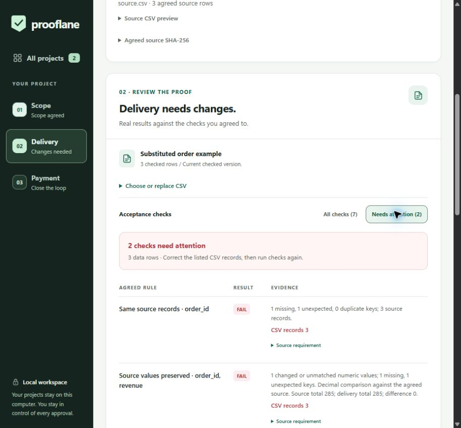

# Source-to-payment implementation and verification

22 October 2026. Local branch: `codex/verified-outcomes`. This implements the [product strategy](PRODUCT_STRATEGY_2026-10-22.md) using the existing standard-library server, SQLite project records and buildless client. No runtime dependencies were added. Earlier inventory/provider evidence remains historical; it does not validate the new seven-rule case.



Actual Chrome interface using the freshly returned Gemini plan and synthetic CSVs. Payments are simulated in this workspace; no PayPal transaction is shown.

## What the judge can try

1. Open All projects and choose **Compare a delivery with its source**. Review the comparison brief, USD price and seven proposed checks. Attach `examples/source.csv` before agreement.
2. Load `examples/substituted.csv`. Its columns, unique IDs, emails, numeric range and row count pass; its total still equals 285. Source reconciliation catches the missing original order and unexpected replacement. Checkout stays blocked.
3. Load `examples/changed-value.csv`. The key set passes but per-order decimal comparison exposes the one-cent revenue change, including source/delivery totals and failing CSV record.
4. Request **Preview source corrections**. Review the before/after values and source records. Applying changes only the in-memory delivery preview. Undo restores that preview; both actions require fresh checks. The preview does not update the saved verification or approval. Expand the CSV preview and **Download this CSV preview** to retain the exact version for later verification; existing files stay unchanged.
5. Run all seven checks and explicitly approve the exact delivery. Complete a simulated checkout for the offline demonstration, or the actual PayPal sandbox checkout when configured. Modes stay visible throughout.
6. Download the evidence, then verify it with both original files in the separate browser verifier or `verify_receipt.py`. Change a delivery value and repeat: the prior success clears and verification rejects it.

The clarification example separately demonstrates an unresolved obligation. A user edits a full revised measurable brief and drafts a new scope at the original exact price. The original project remains saved; the new draft requires review, source attachment and agreement again. This avoids retaining an unresolved vague sentence alongside an appended answer. Gemini can still request further clarification; revised wording never bypasses review.

## Binding and compatibility

Agreement stores the source's SHA-256, row count and column names, without raw rows. Verification requires reattachment of that exact normalized source. Approval adds `prooflane-manifest-v2`, containing the project identity, brief, acceptance plan, integer USD cents, modes, source snapshot, delivery hash and normalization definition. Canonical JSON uses sorted keys, ASCII escapes and compact separators, and rejects non-finite numbers.

New PayPal orders use `pl2:<32-character project id>:<64-character manifest SHA-256>` as `custom_id`. It is 101 characters. The adapter checks this reference and exact USD total on create/readback before recording success or requesting capture. Approval, manifest and receipt hashes must agree. Checkout retains the existing stable request IDs, uncertainty freeze, bounded retry window and reconciliation-before-capture behavior.

The independent verifier recomputes the CSV checks, file/source hashes and manifest from an exported record. It needs no original SQLite database. Optional authenticated sandbox lookup confirms the exact order reference, amount and single completed capture without creating an order or capture. Local consistency alone cannot authenticate a payment; an unsigned export can be rewritten. PayPal records the reference, while Prooflane evaluates the work. Simulated and provider-unverified results are distinct from a confirmed sandbox result.

Existing project JSON needs no database migration. Legacy orders retain their original project-only reference and can still reconcile. Legacy receipts remain readable; the separate verifier explicitly rejects a claim of version 2 binding for them. Existing projects and credentials are preserved.

## Supported limits

- Each UTF-8 CSV: 300,000 bytes, 5,000 data rows and 30 columns. Plans: at most 20 restricted checks. No generated code executes.
- Hash normalization removes leading BOMs and converts CRLF/CR to LF. Other bytes, row order and decimal spelling still affect the file identity.
- Record positions include the header as record 1; a quoted multiline field remains one record.
- Source keys must be nonempty and unique after trimming. Numeric source values compare with `Decimal`, up to 64 characters, 18 decimal places and absolute value 1e12. Totals use sufficient decimal precision for the supported bounds.
- Corrections require exactly one numeric source comparison, an explicit exact-key rule and matching column sets. Conflicting delivery keys require manual resolution. Only source-backed missing records, unexpected records and changed numeric values are proposed; the first 50 changes are shown with the total count. Other failed checks may remain failed.
- Source and delivery rows remain in memory during review. They are neither persisted in SQLite/evidence nor sent to Gemini. Applying corrections never writes a file on disk. Keep both original files to reproduce verification.
- This remains a localhost, single-operator demonstration. Public multi-user hosting, authentication, webhooks, escrow and payouts are outside this change.

## Local verification

The final code passes:

```powershell
& .\.venv\Scripts\python.exe -m unittest -q test_app.py
$env:PYTHON = (Resolve-Path '.\.venv\Scripts\python.exe').Path
node test_client.cjs
& .\.venv\Scripts\python.exe -m py_compile app.py test_app.py browser_check.py verify_receipt.py
git diff --check
```

All **32 backend tests** and the expanded client checks pass. Contracts cover both attacks, decimal edge cases, wrong/missing source, malformed uploads, corrections without state mutation, conflicting records, Apply/Undo guards, the preview download's actual Blob contents/type/filename, new clarification drafts, manifest/amount/reference tampering, pending/repeated captures, legacy compatibility, and the standalone verifier from a directory without the project database. The optional existing `browser_check.py` still covers its original five-rule sample path; it was compiled, not rerun as part of this revision. The CI configuration includes verifier compilation; consult the pull request checks for remote CI results. This report records local validation.

Fresh connected Chrome checks used an isolated sample/simulation database:

- Native source/delivery file selection, both source attacks, all seven checks passing, explicit approval, simulated receipt and actual evidence download.
- The downloaded JSON and both native-selected files pass the separate verifier. A changed delivered file clears success and is rejected. The command-line verifier accepts that same downloaded evidence offline.
- Clarification creates a new project at USD 42.50 while preserving the original draft. Source re-agreement is required.
- Correction preview leaves the delivery unchanged; Apply, Undo, reapply and fresh passing verification work. Changed previews block approval/payment. Verifier success receives keyboard focus; errors retain the existing focus handling.
- Source/delivery results have no horizontal overflow at 320, 390, 768 and 1280px. The correction preview and separate verifier also fit at 320px. Temporary viewport and text-spacing overrides were reset.
- Four axe 4.14.0 scans cover clarification, correction preview, passing results with WCAG text spacing, and verifier success. Zero violations. The library/verifier scan leaves six gradient-background contrast checks incomplete; manual review bounds their contrast at **8.21:1 or higher**, using the brightest gradient composition and actual computed text colors. The other three scans have no incomplete checks. This is not screen-reader or full WCAG certification.

Fresh Gemini probes also passed after the initial transient failure. The source brief returned exactly the seven expected checks, with exact quotations and bounds and no clarification or added restriction. Gemini then blocked the vague source obligation, and a revised measurable brief returned the seven-rule plan at the unchanged USD 42.50 price. The original draft stayed unchanged. Chrome opened that actual revised draft, attached the source through the native chooser, agreed, rejected the substituted delivery and displayed the source-backed correction proposal. The browser connection then dropped; the newly added CSV-preview download still needs its native browser check.

Reproducible local QA artifacts are ignored under `.venv/outcome-proof-2026-10-22/`, including the isolated databases, native download checks, scanner reports and provider diagnostic. The [sanitized provider record](VERIFIED_OUTCOMES_PROVIDER_2026-10-22.json) preserves the initial failure, successful reviewed plans, clarification revision and unpaid sandbox readback. No credentials are included in the reports or exported evidence.

## Live acceptance still open

The first `gemini-3.6-flash` source-brief probe returned HTTP 503 after the existing bounded retry. It did not fall back to the sample plan. The later source-plan and clarification probes described above passed. PayPal sandbox OAuth also succeeded.

A separate **sample AI fixture / actual sandbox** USD 1.00 project successfully created its version 2 order with the expected reference. A fresh authenticated readback confirms the reference and exact USD amount, but reports `PAYER_ACTION_REQUIRED`. Buyer login and approval are pending; no capture or confirmed receipt is claimed for this order yet. This isolates the new PayPal binding from the initial Gemini outage. Completing both services in one fresh source-comparison project remains the final expanded acceptance case. After the user reported reconnecting, the browser tool still listed no available browser, so native verification could not resume.

Independent setup, target-user feedback, current-revision screen-reader/physical-device/native 200% zoom checks, the public video and Devpost submission remain open. The implementation gives the demonstration a stronger failure/correction/payment story; it cannot establish a judging result without that evidence.
